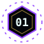
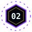
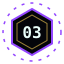
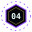
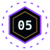

<p align="center">
  
</p>

<div align="center">
  

  <h1 align="center">E U G E N E</h1>

  <p align="center">
    <code>[ FOUNDER & PRINCIPAL ENGINEER ]</code><br>
    <i>Operating across the network: Tokyo // Berlin // Columbus</i>
  </p>

  <p align="center">
    <a href="https://www.linkedin.com/in/eugene-brown-jr-38210b99/"></a>
    <a href="mailto:ecbjr.it@gmail.com"></a>
    <a href="https://github.com/builde7b0b"></a>
  </p>
</div>

<p align="center">
  <a href="#-usrbinabout_me">about_me</a> ·
  <a href="#-tech-arsenal">Tech Arsenal</a> ·
  <a href="#-active-directives">Active Directives</a> ·
  <a href="#-recovered-transmissions">Recovered transmissions</a> ·
  <a href="#-telemetry--stats">Telemetry</a>
</p>

<p align="center"></p>

##  `~/usr/bin/about_me`

```json
{
  "name": "Eugene Brown Jr.",
  "role": "Principal Engineer",
  "status": "Architecting scalable systems and immersive web experiences.",
  "collaboration_targets": ["Appsmith", "Elasticsearch"],
  "ask_me_about": ["PostgreSQL", "JavaScript", "React", "API Architecture"],
  "easter_egg": "I absolutely love Pizza! 🍕"
}
```

<sub>⟁ decoded identity record · signal origin builde7b0b</sub>

##  Tech Arsenal

<p align="center">
  <b>// CORE STACK //</b><br>
  
  
  
  
</p>

<p align="center">
  <b>// CURRENTLY ASSIMILATING //</b><br>
  
  
  
  
</p>

##  Active Directives

<table align="center" width="100%">
  <tr>
    <td width="50%" align="center">
      <h3><a href="https://github.com/builde7b0b/WebGL-Portfolio">🌌 3D WebGL Portfolio</a></h3>
      <p>Immersive interactive portfolio powered by <b>Three.js</b> and <b>Vite</b>.</p>
    </td>
    <td width="50%" align="center">
      <h3><a href="https://github.com/builde7b0b/Gbudy-AI">🤖 Gbudy (OpenAI)</a></h3>
      <p>Intelligent chatbot interface built with <b>React</b> & the <b>OpenAI API</b>.</p>
    </td>
  </tr>
  <tr>
    <td width="50%" align="center">
      <h3><a href="https://github.com/builde7b0b/Full-Stack-Bootcamp-Notes">📚 Full-Stack Architecture</a></h3>
      <p>Comprehensive codebase from the Interapt + GA Full-Stack SE Bootcamp.</p>
    </td>
    <td width="50%" align="center">
      <h3><a href="https://github.com/elastic/elasticsearch">🤝 Open Source Collaboration</a></h3>
      <p>Actively seeking to contribute to <b>Appsmith</b> and <b>Elasticsearch</b>.</p>
    </td>
  </tr>
</table>

<p align="center"></p>

##  Recovered transmissions

Eight public repos, each with its own decoded README. Select a signal to open it.

<table width="100%">
  <tr>
    <td width="50%" valign="top">
      <a href="https://github.com/builde7b0b/dot-companion"></a><br>
      <b><a href="https://github.com/builde7b0b/dot-companion">dot-companion</a></b><br>
      <sub>Dot, a talking AI pet that keeps you company while you build. Works in the browser, even offline.</sub>
    </td>
    <td width="50%" valign="top">
      <a href="https://github.com/builde7b0b/giakts"></a><br>
      <b><a href="https://github.com/builde7b0b/giakts">giakts</a></b><br>
      <sub>GIAKTS: Growing is a knowledge to survive. A vegan and vegetarian food justice movement.</sub>
    </td>
  </tr>
  <tr>
    <td width="50%" valign="top">
      <a href="https://github.com/builde7b0b/voltage-design-kit"></a><br>
      <b><a href="https://github.com/builde7b0b/voltage-design-kit">voltage-design-kit</a></b><br>
      <sub>A source of truth for bold, colorful, section-by-section web brands.</sub>
    </td>
    <td width="50%" valign="top">
      <a href="https://github.com/builde7b0b/stack-doctrine"></a><br>
      <b><a href="https://github.com/builde7b0b/stack-doctrine">stack-doctrine</a></b><br>
      <sub>One platform, one job: Netlify, Supabase, Railway.</sub>
    </td>
  </tr>
  <tr>
    <td width="50%" valign="top">
      <a href="https://github.com/builde7b0b/ios-doctrine"></a><br>
      <b><a href="https://github.com/builde7b0b/ios-doctrine">ios-doctrine</a></b><br>
      <sub>Known-good foundations for iOS apps, Expo and native Xcode.</sub>
    </td>
    <td width="50%" valign="top">
      <a href="https://github.com/builde7b0b/operator-doctrine"></a><br>
      <b><a href="https://github.com/builde7b0b/operator-doctrine">operator-doctrine</a></b><br>
      <sub>Operator prompts, routing doctrine and a workflow-tool blueprint.</sub>
    </td>
  </tr>
  <tr>
    <td width="50%" valign="top">
      <a href="https://github.com/builde7b0b/pitwall"></a><br>
      <b><a href="https://github.com/builde7b0b/pitwall">pitwall</a></b><br>
      <sub>An AI race engineer for the Toyota GR Cup.</sub>
    </td>
    <td width="50%" valign="top">
      <a href="https://github.com/builde7b0b/threadsmith"></a><br>
      <b><a href="https://github.com/builde7b0b/threadsmith">threadsmith</a></b><br>
      <sub>Turn a ChatGPT screenshot into a ready-to-post Twitter thread.</sub>
    </td>
  </tr>
</table>

##  Telemetry & Stats

<p align="center">
  
  
</p>

<p align="center"></p>

<div align="center">
  <blockquote>
    <i>"Architecting the future. Code is the compiler of reality."</i>
  </blockquote>
  <sub>⟁ end of transmission · builde7b0b</sub>
</div>
